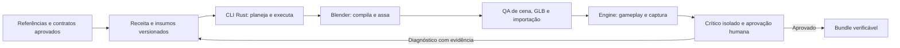

# Code-to-3D — plano de desenvolvimento

**Decisão:** Rust para contratos, execução, rastreabilidade e gates; Blender/Python para malha, rig, animação e bake; engine para importação, controle, VFX, captura e aceitação em runtime. O harness é um sistema de produção de assets, não um novo DCC nem um runtime de jogo.

**Primeiro marco:** guerreiro estilizado com espada equipável, `idle`, `run` e `slash`, rodando a sequência **guarda → corrida → parada → ataque → guarda → corrida**, com efeito sincronizado e vídeo na câmera de gameplay. Uma segunda proporção do mesmo rig e um segundo equipamento demonstram reuso antes de abrir outra família. O caminho de referência deve funcionar sem GPU de ML, sem MCP e sem geradores 3D SaaS. Rust não substitui a direção de arte.

## 1. Decisões e não objetivos

| Decisão | Consequência |
| --- | --- |
| Um alvo inicial: Godot 4 + GLB, **como bancada de prova** se não houver engine de jogo escolhida | Godot recomenda glTF; escolher e fixar a patch do perfil no primeiro marco. Se o jogo já tiver engine, usar seu importador real em vez de construir duas bancadas. A decisão não vincula a engine do produto a Rust ou Godot. |
| Blender 5.2.5 LTS como candidato ao pin inicial | A série 5.3 é estável, mas não é a LTS escolhida. Confirmar build e SHA-256 do binário oficial e registrar em `toolchain.lock.json` após o smoke, junto dos scripts, extensões usadas e perfil do exportador. |
| Primeiro uma família humanoide, com malha base aprovada, rig de controle e esqueleto de jogo próprio | Procedural para variações, equipamento, materiais e partes rígidas. Nenhum requisito de inventar anatomia do zero ou retopologizar toda saída neural para deformação. |
| Código e receita versionados são a autoridade sobre o build, não toda matéria-prima | Bases e referências humanas podem ser insumos binários imutáveis e licenciados. `.blend` intermediário, `.glb`, vídeo e relatórios são saídas, não estado de edição compartilhado. |
| CLI local, uma workspace Cargo, sem daemon ou editor próprio | Adicionar MCP, serviços ou extensibilidade dinâmica só quando uma necessidade medida justificar. Nenhum runtime geral de agentes; quem escreve a receita usa seu agente de código existente. |

Não entram no caminho crítico: múltiplas engines/FBX, escultura neural, autorig de criaturas, física secundária complexa, mocap de vídeo, motion matching, VAT, exportação Niagara, roteamento automático de LLMs, biblioteca universal de rigs. Preservar as divisões acima, não inventar uma interface para cada possível integração.

## 2. Arquitetura e contratos



Começar com um pacote Rust: `src/{main,contract,run,artifact,gate}.rs`, `executors/blender/` como pacote Python e `engine-probe/` como projeto de teste. `assets/<id>/` contém a receita e referências; `families/humanoid_v1/` contém contrato do rig, mapa de ossos, biblioteca de poses e referências de deformação; `profiles/` guarda regras da engine, câmera, exportação e tolerâncias; `fixtures/` guarda entradas mínimas de QA. Separar crates apenas ao surgir um consumidor independente. `clap` e `serde`/`serde_json`, subprocessos supervisionados e arquivos no mesmo filesystem bastam para começar. Dados pesados ficam nos artefatos; o Rust não rematerializa malha nem buffers de animação para passar ao Python.

| Contrato | Autoridade e campos mínimos |
| --- | --- |
| `asset.json` | `schema_version`, `asset_id`, `family`, referências com digest, dimensões/tolerâncias em m, componentes, material por slot, sockets, lista de clips e perfil alvo. Parâmetros existentes são dados; operações novas são código revisado no executor. |
| `rig.json` | IDs estáveis de ossos, hierarquia, bind/rest pose, eixos, escala, raiz, papéis de controle versus deformação, sockets e pontos de amostragem. Quebra de hierarquia/rest pose exige nova versão da família e retarget explícito. |
| `motion.json` | `clip_id`, `rig`, `tick_hz`, duração, poses por tick e fase, perfil de interpolação, modo de root, contatos anotados, eventos tipados, parâmetros de transição e referência de revisão. |
| `request.json` → `result.json` | `protocol_version`, ID da execução e da etapa, operação registrada, parâmetros, insumos declarados com digest, saídas relativas ao staging. Resposta: mesmo ID/versão, status, saídas, métricas e diagnósticos. Logs separados; exit zero sem resultado válido ou sem saídas esperadas é falha. |
| `manifest.json` | Receita/lock, executores e seus digests, grafo e chaves, versões, seeds, ambiente relevante, recursos/tempos, checksums de saídas e evidência, gates e aprovações ligadas ao digest do candidato. `failed`, `blocked`, `cancelled` e `not_run` não viram `pass`. |

JSON estrito em contratos de produção: campos desconhecidos, unidades erradas, IDs duplicados, referências faltantes e números não finitos são erros. Tipos Rust são a autoridade do protocolo; compartilhar schemas e fixtures de conformidade com Python e GDScript, sem reimplementar toda a regra de negócio nos três lados. Em evolução incompatível, subir a versão e falhar com mensagem de migração; não adivinhar defaults silenciosos. Convenção canônica: m, Blender Z-up e `+Y` frente autoral; relógio do clip em ticks inteiros. O perfil de exportação é o único lugar para a mudança de base. Fixture assimétrica, com marcador de frente e socket fora da origem, prova orientação, handedness, unidade e ausência de rotação duplicada. A frente visual não é inferida da convenção da câmera.

### CLI e publicação

Comandos planejados, ainda não implementados:

```text
c23d doctor --profile godot-glb
c23d plan assets/warrior/asset.json --profile godot-glb --json
c23d build assets/warrior/asset.json --profile godot-glb
c23d inspect <run-id> --json
c23d verify <run-id> --through runtime
c23d review <run-id> --decision-file approval.json
c23d publish <run-id>
```

`plan` resolve entradas e mostra etapas selecionadas; `build` escreve um candidato, nunca a pasta publicada; `verify` lê o candidato imutável e vincula os relatórios de origem, reimport e runtime; `review` anexa uma decisão ao digest do candidato, perfil e pacote de evidência, sem mudar o candidato. `publish` valida todas as evidências exigidas, inclusive licença e aprovação final, e só então troca atomicamente a referência ao bundle composto por GLB, sidecar de gameplay, import settings e proveniência. Um rerun idêntico pode reusar saídas; um candidato diferente não herda aprovação. Saídas estáveis de CLI: `0` sucesso da operação solicitada, `1` falha de execução, `2` erro de uso/contrato, `3` gate reprovado ou bloqueado, `130` cancelamento por interrupção; status granular em JSON. `verify --through runtime` não equivale a publicação.

### Execução, isolamento e reprodução

- Primeira versão: sequência de etapas registradas com dependências explícitas, manifestos JSON por execução e escrita atômica em disco. Uma chave de etapa inclui implementação/versão do protocolo, perfil, parâmetros canônicos, digests das entradas e configuração de execução relevante. Separar identidade do resultado (hash dos bytes), chave de reuso (hash dos insumos) e ID da tentativa. Não construir scheduler distribuído, SQLite ou CAS remoto para um único host. Introduzir cache por etapa só depois de provar o rebuild frio; publicar por rename no mesmo filesystem e não consumir staging incompleto.
- **Reconstrução** é reexecutar a receita em ambiente fixado e comparar invariantes/medidas dentro de tolerâncias, não prometer GLB ou pixels byte a byte em todo hardware. **Replay** é reutilizar a saída original verificada pelo digest. Saída neural escolhida vira insumo explícito com hash: seed, checkpoint e driver ajudam a reproduzir a tentativa, não garantem regeneração idêntica. Registre também qual build consumiu qual tentativa.
- Subprocessos com `argv` fixo, sem shell, ambiente filtrado, HOME temporário e sem segredos; Blender background com factory startup, autoexec desabilitado e `--python-exit-code` não zero, argumentos da receita após `--`. Salvar logs com limites, timeout por operação, matar/recolher árvore no cancelamento e gravar o motivo; saída parcial nunca é hit de cache. Runner só executa entrypoints revisados. Desabilitar autoexec não restringe o Python desses entrypoints: rodar parsers, add-ons e scripts em isolamento de SO com insumos read-only, staging dedicado, sem diretório pessoal, sem rede por padrão e com limites de recursos. Caminhos absolutos de usuário, traversal, symlink de saída e leitura fora do workspace de execução são rejeitados na fronteira. Não expor execução Python por MCP nem deixar o agente alterar verificador/limites durante uma rodada de produção.
- Insumos binários, relatórios e nomes de cena são dados não confiáveis; não podem alterar comando, regra ou instrução do crítico. Agentes mudam receitas em propostas isoladas e um integrador aceita os patches. A interface padrão é a CLI + operações semânticas (aplicar pose, ajustar fase, prender contato, instanciar material, capturar revisão); API RNA da build real para diagnosticar drift. Criar índice offline ou skill por domínio só quando houver operações estáveis para documentar. Cada skill cita comandos da CLI e exemplos verificáveis; convenções do projeto ficam no perfil/contrato, não em memória solta de chat.

**Falhas que precisam de contrato próprio:** `doctor` informa capacidades e recusa entrada externa se não houver isolamento efetivo. No Linux, usar contenção por job (ex.: cgroup v2 delegado) com término gracioso seguido de kill e confirmação de que não restaram descendentes antes de liberar recursos. Reservas recuperadas após queda só são reutilizadas quando se prova que o job anterior terminou. Cancelamento e commit de publicação têm um único vencedor; cancelado não publica e, após o commit, o resultado é publicado. Digests SHA-256 de bytes e manifesto canônico, com timestamps e logs fora da chave; QA só é reutilizável se também coincidirem versão e critérios do gate. Replay offline verifica hashes e falha explicitamente se faltar um blob, sem rebuild implícito.

## 3. Fluxo de produção: animação primeiro

1. **Direção e blocking.** Aprovar uma bíblia de uma página com três silhuetas no tamanho real, proporções, paleta por função, materiais em duas luzes e contraexemplos anotados. Direção candidata: **Sal e Ferro**, fantasia mineral de gravura talhada, massas truncadas assimétricas e acento reservado ao efeito; usar a economia gráfica das referências sem copiar sua identidade. Base em quads com deformação observável em ombro, cotovelo, quadril e joelho. Importar base própria/licenciada; avaliar MPFB2 só se a base e os termos servirem à estética. Rigify é candidato para o rig de controle, não contrato de exportação. Usar esqueleto de jogo explícito com `Root`, ossos de deformação e sockets previstos pelo perfil, sem ossos de controle acidentais. Bind/rest pose e escala fazem parte do protocolo.
2. **Dirigir o gesto.** Fixar poses de guarda, antecipação, passagem, impacto, continuação e recuperação; aprovar pose/silhueta na câmera de gameplay antes de interpolar. `idle` e `run` têm fase e fechamento de ciclo; `slash` tem entrada/saída e janelas, não é um loop. Usar poses e curvas dirigidas ou movimento aprovado/licenciado como referência inicial; o caminho oficial não depende de Kimodo. Exemplo de contrato: a 120 ticks/s, ataque de 108 ticks, impacto no tick 46, dano em `[41, 52)`, cancelamento a partir de 78. São valores ilustrativos, não decisões de balanceamento. Intervalos são semiabertos, tick 0 é o começo, o sample de fechamento do loop é comparado mas não tocado duas vezes.
3. **Produzir e polir.** Retarget por mapa explícito de repouso, ossos, eixos, unidades e comprimentos de membros; preservar ritmo e estilizar antes de resolver contato. Aplicar IK em mundo com alvos por fase, rampa e pole vector, plantio por âncoras de sola e mão no socket; reaplicar e medir após retiming. `idle`/`slash` in-place; `run` in-place a velocidade de controlador inicial de 3,5 m/s, com passada/cadência casadas ao deslocamento medido. Para futura ação com root motion, uma só autoridade aplica o deslocamento e considera colisão. Bake visual no rig de jogo com Action Slots/Channelbags, sem `action.fcurves` e sem assumir que o primeiro channelbag cobre uma Action multicamada. Filtrar só ruído residual; preservar impacto, pausa, toe roll e exagero aprovado.
4. **Exportar o que a engine consome.** GLB com malha, skin, materiais e pistas assadas. Sidecar JSON contém tempos, janelas, sockets e IDs de clips, vinculado ao GLB pelo manifesto. O controlador detecta cruzamento de instantes entre amostras, incluindo janelas mais estreitas que um tick de simulação, evita sinal duplicado em blend, rearma no novo ataque e fecha a janela em interrupção. Começar com blends de 80–150 ms, casando o apoio ou liberando-o explicitamente; sem travar o pé além do alcance da perna. O jogo não depende de markers, drivers, constraints ou grafos Blender viajarem pelo GLB. A bancada Godot exercita a importação de editor com settings de produção, não apenas `GLTFDocument` em memória.
5. **Materiais e VFX.** Começar por tecido, couro e metal fosco com poucos parâmetros. Hachura ancorada às UVs/asset, filtrada à distância; revisar cintilação, costura e aderência em movimento sob duas luzes. Albedo sRGB sem luz direcional assada, dados lineares, normal tangente +Y e canais ORM quando usados. Shader compartilhado na engine e um efeito simples: aviso, arco recortado e dissipação; burst de impacto só no hit, não no whiff. O efeito comunica direção/alcance sem sugerir dano após o fim da janela. Capturar com e sem VFX, com cenário, HUD e concorrência representativa; medir delta de GPU p95 sobre o mesmo replay. ComfyUI só entra se melhorar a aparência na engine.

## 4. Gates e evidência

A Camada 1 mede integridade e comportamento; a Camada 2 avalia direção artística e leitura. Ambas precisam passar para publicar. Gate aprovado exige evidência presente. Budget/tolerância são do perfil e da classe de asset; cada diagnóstico carrega regra, severidade, valor/limite/unidade, clip/intervalo, espaço de medição, objeto/junta e link para evidência. Erro de infraestrutura não é reprovação artística. Exceções (aberturas legítimas, overlaps intencionais, contatos esperados) são delimitadas e revisadas no perfil antes da tentativa, nunca uma lista genérica para fazer o candidato passar.

| Gate | Bloqueios e artefatos |
| --- | --- |
| **Estrutura e pose** | Malhas avaliadas não vazias, dimensões, escala, orientação, pivôs e sockets; topo/UV e orçamento por componente onde aplicável, com contagem também pós-export. Skin sem vértice órfão ou pesos inválidos, hierarquia/raízes esperadas, base de deformação em poses extremas. Checker UV e wireframe por diagnóstico; não exigir manifold fechado para toda superfície. |
| **Movimento** | Restrições por clip/fase, pé/mão em mundo, penetração, junções do loop, empunhadura, deformação, colisões proibidas e eventos dentro do contrato. Sinalizar jerk e overshoot por fase; não impor suavidade global. Avaliar a cena após constraints e repetir em export/runtime. |
| **Artefato e runtime** | `glTF-Validator`, reimport em processo Blender limpo e importação real na engine. Comparar bounds, eixos, hierarquia, joints, sockets, tracks e duração, poses-chave e amostras entre elas com métricas, não contagem de nomes apenas. Na cena de jogo testar start/stop, ataque a partir de corrida, retorno, interrupção, dois ataques consecutivos e mudanças de direção. O teste roda até observar estado, deslocamento, eventos e VFX corretos; retornar código zero/importar arquivo é insuficiente. |
| **Revisão visual** | Mesmo perfil de câmera, enquadramento, luz e contexto. Revisar primeiro vídeo sem cortes à velocidade e escala do jogo; câmera lenta, poses/folha com ticks e overlay servem ao diagnóstico. Crítico recebe rubrica, referências e pacote sem histórico/autoria do construtor; retorna `pass/fail/not_observable` por critério, com vista, intervalo, parte e defeito. Falta de evidência bloqueia o critério. Humanos aprovam direção, poses e gameplay final; crítico não aprova sozinho nem altera gate técnico. |

### Métricas a calibrar no piloto

Valores abaixo são limites iniciais propostos para um humanoide de cerca de 2 m em pista plana, não números verificados nem promessas artísticas. Calibrar com uma sequência aprovada e versões intencionalmente quebradas; congelar o perfil antes da avaliação cega. Tolerâncias sempre publicadas junto da medida, e alteração de perfil invalida a aprovação anterior.

| Regra | Medição e limite inicial |
| --- | --- |
| Pé plantado e piso | Distância horizontal máxima à âncora de plantio ≤ 20 mm na fase rígida, não só deslocamento entre primeiro e último frame. Penetração da sola ≤ 10 mm na pista plana; em apoio também sinalizar altura > 20 mm. Reportar máxima e p95 de velocidade; medir ponto de sola em mundo, incluindo controlador e blend em runtime. Toe roll usa âncora específica; voo é avaliado pelo contrato, não marcado como falta de contato. |
| Grip e socket | Erro de posição ≤ 10 mm e angular ≤ 5° no grip exigido, medidos entre frames ortonormais do socket e da mão, não só entre origens dos ossos. Acessório equipado precisa respeitar o mesmo referencial após export. |
| Junção de loop | Após remover o deslocamento esperado do root: erro de posição em marcadores ≤ 10 mm e rotação ≤ 3°. Medir diferença de velocidade em ambos os lados com passo fixo (limite inicial: 0,15 m/s nos marcadores de apoio); pose idêntica com tangente descontínua não passa em `idle`/`run`. |
| Paridade fonte → jogo | Juntas e sockets amostrados na mesma base: erro inicial ≤ 5 mm e ≤ 2° após conversão da base, inclusive entre chaves. Fixar a precisão de bake/export por perfil com esta medida, não pela aparência de um frame. |
| Colisão e deformação | Pares proibidos declarados (ex.: acessório vs. face/tronco). Broad phase com proxy, narrow phase em intervalo de risco e subamostragem; distinguir toque, interpenetração e contatos permitidos. No runtime, varrer a hitbox entre poses durante a janela ativa; para o QA de malha, registrar taxa/resolução e pares cobertos. Amostragem finita não prova ausência de colisão contínua. Para skin, usar poses extremas aprovadas, detectar triângulos invertidos/colapsados com referência local e comparar alongamento por região; não exigir rigidez de tecido. |
| Eventos e transições | A cada sequência, evento ocorre uma vez por instância e em ordem, janela fecha inclusive em interrupção, VFX dispara com início esperado, retorno de controle bate com configuração. Medir em ticks da simulação, não fps do render; tolerância de observação de um tick, sem atraso acumulado. |

Amostra inicial: bake a 60 Hz, QA do clip a 120 Hz mais instantes de evento/limites de fase, subamostragem adaptativa perto de colisão rápida. Na bancada, simulação a 60 Hz com repetições a 30/60/120 FPS de render para provar que controle, dano e VFX não dependem dessa taxa; separar ticks do clip, da simulação e do render no trace. Fixtures mínimas: GLB válido vazio, eixos ou escala quebrados, clip com pé em deriva, perda de continuidade, socket incorreto e evento perdido/duplicado em transição. Cada uma precisa reprovar **a regra correspondente**; candidato de referência deve passar no conjunto. Verificadores e fixtures são trabalho do harness, nunca delegados ao construtor do asset durante uma avaliação.

## 5. Roadmap executável

| Marco | Trabalho e dependências | Aceite observável |
| --- | --- | --- |
| **M0 — Congelar bancada** | Selecionar perfil/patch, ferramenta Rust e binários; confirmar Blender headless e importador; fixar câmera, referências, rig base original/licenciado, métricas provisórias e `style brief`. | Fixture assimétrica com mesh, duas juntas, socket e um clip exporta GLB, importa na bancada e reproduz a pose esperada. Registrar versões reais e checksums. Não começar a expansão de ferramentas antes deste round-trip. |
| **M1 — Caminho frio e verificador** | CLI, contratos, runner isolado, relatórios, publicação atômica, teste GLB válido/vazio e eixos. Definir orçamento de execução antes de automatizar repetições. Depende de M0. | Duas execuções frias do fixture chegam aos mesmos invariantes; rejeitar contrato inválido antes de spawn. GLB vazio bloqueia mesmo com saída zero. Corrupção e timeout com descendente não deixam publicação ou processo órfão; corrida de cancelamento/publicação tem um vencedor verificável. |
| **M2 — Rig e animação** | Rig mestre, export rig, pose library, composição dos três clips, gate de deformação e cinemática, primeiro ajuste de contatos e sidecar. Arte/base e probe da engine avançam em paralelo após o contrato M0; integração passa por M1. | Aprovar blocking na câmera, provar que fixtures negativas de clip falham e que clips bons passam antes e depois da exportação/importação. Separar erro de autoria, conversão e runtime no relatório. |
| **M3 — Entrega jogável** | Controlador/estados, transições, VFX/material de produção do piloto e revisão cega; logs automáticos e captura. Depende de M2 para o resultado final. | Vídeo na engine e traces da sequência do marco, incluindo interrupção e reentrada; aprovação humana ligada ao bundle; build e revisão reproduzíveis sem qualquer gerador neural. |
| **M4 — Reuso e decisão de expansão** | Segunda proporção e equipamento, experimento A/B/C, cache por etapa se o custo medido exigir. Somente aqui Kimodo pode entrar como braço experimental, após licença e smoke. | Segunda variação não altera o verificador nem depende de correção manual do GLB; resultados de todas as tentativas publicados internamente, nova capacidade habilitada só se superar o controle conforme protocolo. |

**Primeiro PR:** contrato fixo de perfil/fixture e round-trip assimétrico da M0, antes de abstrações do scheduler. Provar o caminho executando Blender e o importador, comparando escala, frente, pose e socket. O PR seguinte endurece o caso negativo do GLB vazio e a publicação. CI de PR roda testes de contratos, runner e round-trip leve em CPU; visual/runtime com renderizador real em job de aceitação na máquina-alvo. Evidência headless não substitui vídeo/captura renderizada na bancada. Manter somente operações usadas pelos marcos, testando novos consumidores em vez de testar apenas wiring.

**Divisão após M0:** o dono do runner entrega protocolo/artefatos; o de Blender entrega fixture, rig e bake; o de engine entrega importação, replay e eventos; direção/QA mantém referências, negativos e rubrica. Trabalhar nos limites de arquivos dessas fatias em paralelo com um único integrador para o contrato e nenhum `.blend` compartilhado em edição. Antes de M3, fixar o orçamento com base em hardware, renderizador e número de instâncias simultâneas do alvo, medindo p95 de CPU de pose/blend/IK e delta de GPU do efeito sobre o mesmo replay.

## 6. Experimento, operação e expansão

**Comparação:** A = mesmo LLM com Blender/scripting direto, livre para iterar; B = receita, ferramentas semânticas, gates e crítico; C = B com Kimodo SOMA como proposta de movimento. Todos entregam o mesmo pacote ao verificador externo. Emparelhar B/C no mesmo checkpoint pré-movimento e cobrar a etapa comum nos dois; debitar geração, seleção e crítico dos braços que os usam. Fixar LLM/effort, briefing e insumos autorizados, hardware, teto de parede/custo/tokens/assistência humana, rubrica e corte de entrega. Sessões limpas, ordem aleatória, um resultado final por tentativa selecionado pelo fluxo antes do painel. Após calibração fora da amostra, rodar 3 briefs lacrados × 5 repetições por braço (15 blocos pareados); registrar todas, inclusive ausência de entrega, timeout e estouro de teto. Se C não passar licença/viabilidade, executar A/B e registrar C como não elegível, não como qualidade zero.

Três revisores avaliam isoladamente e sem autoria/braço: silhueta/identidade, material em movimento, legibilidade da ação, peso/ritmo e VFX. Escala 0–4, `3` significa aceitável para jogar; exigir dois de três com `≥3` em cada eixo e nenhum bloqueador confirmado. Numa prova curta separada de gameplay, jogadores sem exposição ao briefing devem identificar direção, janela e diferença hit/whiff na escala real. Registrar votos brutos, empates, aprovações por brief, defeitos e custo/tempo de intervenção por aprovado (incluindo falhas); preferência pareada só entre pares julgáveis, com denominador explícito. Nenhuma métrica de similaridade, nota de VLM ou showreel escolhido pela equipe substitui esse resultado.

**Go/no-go:** M3 exige todos os gates e aprovação humana da sequência jogável sem ML. Para ampliar a mesma família, piso inicial de B: **12/15 aprovados, ao menos 3/5 por brief**, sem bloqueador sistêmico. Além disso, exigir três aprovações a mais que A sem piora por brief nem aumento de custo por aprovado, **ou** não inferioridade por brief com ≥25% de redução desse custo. Se A não aprovar nenhum, usar teto absoluto fixado na calibração. C deve passar o mesmo piso, sem queda por brief, e trazer pelo menos duas aprovações adicionais com custo por aprovado não superior, **ou** manter aprovações e reduzir esse custo em ≥20%. Esses são limiares propostos de decisão, não um teste de significância; congelar antes das rodadas. Distinguir ganho de confiabilidade de superioridade artística com as preferências cegas. No fluxo de produção, até três rodadas de reparo por candidato; esgotadas, escalar para decisão humana em vez de ampliar tolerâncias.

**GPU:** inventário `nvidia-smi` retornou duas RTX 3060 com **12.288 MiB cada**, não 24 GB para um job. Na integração GPU, usar reserva host-local por UUID físico e provar o dispositivo efetivamente usado pelo backend. Uma tarefa pesada por placa, com folga para desktop/render e limites de RAM do host; testar dois jobs simultâneos, falha por falta de capacidade e término com descendente. Não liberar reserva enquanto o processo estiver vivo. A máscara CUDA, sozinha, não serve como isolamento nem vincula renderizadores não CUDA.

**Spike Kimodo:** implementação oficial, checkpoint `Kimodo-SOMA-RP-v1.2` e revisão explícitos. O [guia NVIDIA](https://research.nvidia.com/labs/sil/projects/kimodo/docs/getting_started/quick_start.html#recommended-hardware) documenta ~17 GB na GPU ou <3 GB de VRAM com `TEXT_ENCODER_DEVICE=cpu`; não é medição da 3060, nem depende do port C++. Provisionar o encoder e pesos antes da execução e verificar termos do [Llama 3](https://github.com/meta-llama/llama3/blob/main/LICENSE) e dependências. Medir latência fria/quente com pesos já instalados, pico de VRAM/RSS e minutos de correção. Preferir NPZ de 77 juntas em T-pose (modelo opera em 30, saída expande para 77), 30 fps, m e Y-up; BVH exporta em cm e tem repouso BONES-SEED por padrão. Contatos no NPZ são evidência candidata, não verdade do rig; validar escala, retarget e contato no jogo. Se não couber ou não entregar ganho, preservar B, sem trocar checkpoint silenciosamente.

**Licenças:** inventário por digest com fonte, termos de código, pesos principais/auxiliares, dataset quando aplicável, referências e direitos de uso dos outputs, territórios e redistribuição. Desconhecido ou incompatível bloqueia promoção comercial. A [licença NVIDIA do SOMA](https://www.nvidia.com/en-us/agreements/enterprise-software/nvidia-open-model-license/) permite uso comercial sujeito aos termos; não equivale a aprovação de toda a cadeia. Distribuir clips, não pesos. Não usar Kimodo SMPL-X (R&D), [UniMate com pesos não comerciais](https://huggingface.co/Linzhan/UniMate) nem [HY-Motion](https://huggingface.co/tencent/HY-Motion-1.0/blob/main/LICENSE.txt)/[Hunyuan3D 2.1](https://github.com/Tencent-Hunyuan/Hunyuan3D-2.1/blob/main/LICENSE) no perfil comercial global: há restrições territoriais inclusive sobre outputs. Não presumir que licença GPL da ferramenta ou MIT do repositório cobre toda a cadeia de artefatos.

**Entrada de novas rotas, depois de M4:** hard-surface rígido em Blender/Python; CAD apenas se precisar de precisão que as operações atuais não atendam; ambientes via Geometry Nodes sob demanda repetida. Autorig e retopo neural são preparação, não atalho para deformação. [SkinTokens](https://huggingface.co/VAST-AI/SkinTokens) publica ≥14 GB para inferência; [TRELLIS.2 upstream](https://github.com/microsoft/TRELLIS.2), ≥24 GB em uma GPU. Variantes otimizadas ou alternativas só entram após provar VRAM, licenças da cadeia e ganho. Pintura multivista sobre malha/UV aprovadas, com luz neutra e revisão em movimento. Adaptador [ComfyUI](https://docs.comfy.org/development/comfyui-server/comms_routes): templates em API Format fixados com nós/pesos e parâmetros permitidos, eventos correlacionados por execução, reconciliação por histórico e diagnósticos de nós; cancelar espera não é cancelar execução. Sem grafo livre/instalação automática. VAT/flipbooks e plugins de engine só quando o VFX corrente mostrar uma limitação mensurável.

## 7. Base documental e limites

- [Pesquisa GPT](pesquisa-gpt.md): direção por poses/timing, rig por família, materiais estilizados, limitações do Kimodo e avaliação em jogo. [ProcFunc](https://github.com/princeton-vl/procfunc) dá evidência a favor de operações especializadas em tarefas procedurais, principalmente materiais; [Blendy](https://github.com/Ut8v/blendy) inspira contratos/checkpoints, não comprova rigging ou personagem pronto.
- [Pesquisa Gemini](pesquisa-gemini.md): build headless, ancoragem da RNA, gates, separação construtor/crítico, rotas distintas por asset e riscos de licenças. Taxa de script executável, teste de um carro ou preferência em objetos estáticos não medem a qualidade do ARPG; não usar rankings de LLM nem extrapolar os números para animação.
- Referências de implementação: [Blender 5.2 LTS](https://developer.blender.org/docs/release_notes/5.2/), [binários e hashes](https://download.blender.org/release/Blender5.2/), [migração de Animation API](https://developer.blender.org/docs/release_notes/5.0/python_api/#animation-rigging), [Action Slots/Channelbags](https://docs.blender.org/api/5.2/bpy_extras.anim_utils.html), [Blender glTF](https://docs.blender.org/manual/en/5.2/addons/scene_gltf2.html), [importação Godot](https://docs.godotengine.org/en/stable/tutorials/assets_pipeline/importing_3d_scenes/available_formats.html) e [Khronos glTF Validator](https://github.com/KhronosGroup/glTF-Validator). Cada doc informa o desenho, mas não substitui smoke no binário fixado.
- Candidato neural, não dependência: [Kimodo SOMA v1.2, model card e licença](https://huggingface.co/nvidia/Kimodo-SOMA-RP-v1.2), [formatos](https://research.nvidia.com/labs/sil/projects/kimodo/docs/user_guide/output_formats.html), [restrições](https://research.nvidia.com/labs/sil/projects/kimodo/docs/key_concepts/constraints.html), [métricas](https://research.nvidia.com/labs/sil/projects/kimodo/docs/benchmark/metrics.html). Movimento humano plausível não equivale ao acting estilizado do jogo; contatos e retarget permanecem responsabilidade do harness. Nenhum benchmark nas RTX 3060 ou smoke dos executores foi rodado para este plano.
