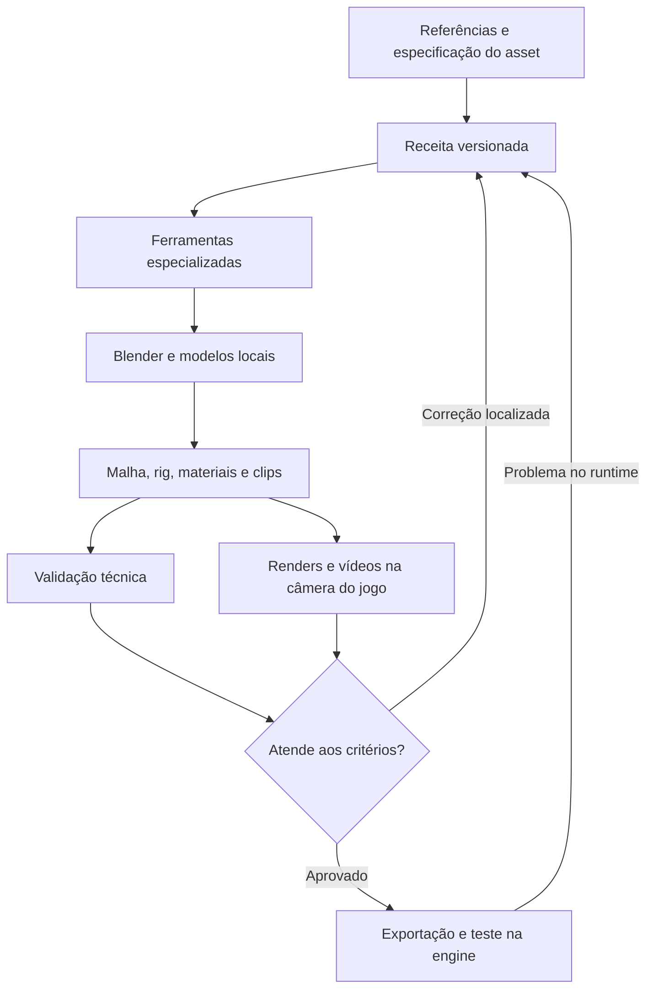

Você tem razão em cobrar. **Minha resposta anterior anunciou uma pesquisa, mas não entregou os resultados nem as fontes.** Agora fiz buscas e abri artigos, repositórios e documentação. Abaixo estão as fontes e o que elas permitem concluir — incluindo os limites.

**Minha recomendação para o seu caso é construir um harness de produção com operações especializadas, um rig reutilizável, animação dirigida por poses e restrições, e avaliação dentro do jogo.** Encontrei projetos que implementam partes importantes disso. Não encontrei, nas fontes consultadas, uma solução pública que demonstre entregar autonomamente personagens originais, texturizados e animados com qualidade artística extraordinária de ponta a ponta.

Esta foi uma pesquisa documental: **não executei esses projetos nem fiz benchmarks nas suas RTX 3060**. Os números abaixo vêm das fontes identificadas; a arquitetura proposta é minha recomendação de engenharia.

# 1. As fontes que respondem diretamente à sua pergunta

Estes são os trabalhos mais relevantes para entender **por que simplesmente dar acesso ao Blender a um agente costuma ser insuficiente**.

| Fonte | O que existe de concreto | O limite da evidência |
|---|---|---|
| [BlenderAlchemy](https://ianhuang0630.github.io/BlenderAlchemyWeb/) | Geração de edições por código, renderização, avaliação visual, escolha entre alternativas e retorno a versões anteriores. | Demonstra principalmente edição de materiais, geometria procedural e iluminação. Parte dos exemplos usa assets feitos previamente por artistas. |
| [ProcFunc — Princeton](https://github.com/princeton-vl/procfunc) | Uma API de funções Python para criação procedural, com experimento comparando erros dos modelos ao usar interfaces diferentes. | O resultado mais diretamente relevante é sobre materiais procedurais; não demonstra um personagem animado completo. |
| [3DHarnessBench](https://arxiv.org/html/2609.06535v1) | Compara imagem única, múltiplas vistas, exploração visual e acesso a informações geométricas pelo Blender. | É reconstrução de um objeto existente. No modo mais completo, o agente pode consultar o objeto 3D de referência. |
| [BlenderWorld](https://arxiv.org/html/2610.23986v1) | Avalia entregas `.blend` em 223 tarefas, com critérios visuais e estruturais. | Mesmo o melhor resultado reportado cumpre todos os critérios em apenas 42,2% das tarefas. |
| [Blendy](https://github.com/Ut8v/blendy) | Um harness de agentes Claude Code que editam documentos JSON, compilados para cenas Blender, com validadores e checkpoints. | O próprio autor informa que rigging, posing e revisão orientada por referência ainda não estão implementados. |

Essas descrições estão nos projetos e artigos originais. [ianhuang0630.github.io](https://ianhuang0630.github.io/BlenderAlchemyWeb/?utm_source=chatgpt.com)

## O achado mais útil: a interface oferecida ao agente muda o resultado

O **ProcFunc** traz uma evidência especialmente alinhada à sua ideia. No experimento de criação de materiais do zero, mudar a interface de programação reduziu as etapas com erros:

- Gemini 2.5 Pro: **30,3% → 4,9%**.
- GPT-5.2: **44,7% → 21,4%**.

O protocolo tinha documentação, cinco exemplos e oito rodadas. Isso **não prova melhoria equivalente em animação**, mas mostra que existe ganho mensurável ao oferecer uma abstração melhor para o agente. A escolha do LLM é apenas uma parte do sistema. [arxiv.org](https://arxiv.org/html/2604.26943v1?utm_source=chatgpt.com)

Já o **3DHarnessBench** mostra que acesso mais rico à referência pode melhorar a reconstrução. Porém, precisamos interpretar corretamente: consultar medidas de um objeto que já existe é uma vantagem que você não terá integralmente ao inventar um personagem a partir de concept art. [arxiv.org](https://arxiv.org/html/2609.06535v1?utm_source=chatgpt.com)

**Minha conclusão a partir dessas fontes:** vale investir em ferramentas que expressem decisões de produção — proporções, poses, contatos, materiais e deformações — e em evidências que permitam avaliar essas decisões.

# 2. O que “code-to-3D” precisa significar no seu projeto

Eu separaria três abordagens, porque elas têm custos e expectativas diferentes.

| Abordagem | Como funciona | Onde eu a aplicaria |
|---|---|---|
| **Geração procedural por código** | Scripts constroem geometria, materiais, rig e movimento. | Props, armas, arquitetura, vegetação, acessórios, VFX e famílias de personagens bem delimitadas. |
| **Código operando bases reutilizáveis** | O agente modifica uma malha, um rig ou um gerador previamente aprovado. | Personagens equipáveis, variações de corpo, roupas e bibliotecas de animação. |
| **Código orquestrando modelos especializados locais** | O agente controla geradores de movimento, pintura multiview ou reconstrução, e depois corrige os resultados. | Obter propostas iniciais e movimentos de base, mantendo controle sobre a entrega final. |

**Eu combinaria as três.**

Se o requisito for “o LLM deve inventar toda a anatomia e todas as curvas de animação do zero, em cada pedido”, eu trataria isso como um experimento. Para construir o seu ARPG, começaria por uma família de personagens e ampliaria o vocabulário de produção conforme os resultados fossem aprovados.

No seu caso, isso pode ser uma vantagem: guerreiro, arqueiro e bruxo podem compartilhar convenções de esqueleto, equipamentos e animação, enquanto proporções, postura, silhueta e movimento preservam a identidade de cada um.

# 3. Animação: a peça mais promissora que encontrei

## NVIDIA Kimodo — geração de movimento com controles explícitos

O projeto que mais se aproxima do que eu procuraria para a camada de animação é o **[Kimodo, da NVIDIA](https://github.com/nv-tlabs/kimodo)**.

Ele permite condicionar movimento por texto, poses completas em frames específicos, posições e rotações de extremidades, trajetórias e pontos de passagem. Possui código, interface local, CLI e documentação das restrições. Essa capacidade de receber direção estruturada é o que o torna interessante para um harness. [GitHub](https://github.com/nv-tlabs/kimodo?utm_source=chatgpt.com)

### Há uma limitação decisiva para o seu estilo

O próprio [model card do Kimodo-SOMA-RP-v1.2](https://huggingface.co/nvidia/Kimodo-SOMA-RP-v1.2) informa que:

- Seu objetivo é movimento humano realista.
- Não oferece, como capacidade geral, movimento cartoon ou fisicamente implausível.
- Não percebe os objetos existentes ao redor do personagem.
- Pode apresentar escorregamento dos pés e falhas de aderência ao pedido.

Portanto, eu o usaria como **fonte de movimento de base**, seguida de direção e edição estilizada. Isso é particularmente importante para o visual inspirado em Don’t Starve que você está buscando. [Hugging Face](https://huggingface.co/nvidia/Kimodo-SOMA-RP-v1.2?utm_source=chatgpt.com)

## Como eu construiria uma animação boa de verdade

A sequência abaixo é **minha proposta**, apoiada nos controles disponíveis e nas limitações documentadas.

### Etapa A — Definir a ação como uma especificação de gameplay

Antes de gerar movimento, o harness precisa saber:

- Qual é a duração da ação?
- Quando o golpe deve ficar legível?
- Em que momento acontece o impacto?
- Qual pé sustenta o personagem?
- A arma precisa atingir qual região?
- O personagem pode se deslocar?
- Quando o jogador recupera o controle?
- Qual é a pose de entrada e de saída?

Para um ataque de espada, eu usaria algo assim:

```yaml
clip: warrior_slash_01
rig: humanoid_master_v1
duration_seconds: 0.9
root_mode: in_place

poses:
  ready: warrior_guard_v2
  anticipation: slash_windup_v3
  impact: slash_contact_v1
  recovery: warrior_guard_v2

events:
  impact_seconds: 0.38
  damage_window_seconds: [0.34, 0.43]
  cancel_allowed_after_seconds: 0.65

constraints:
  planted_foot: left
  weapon_grip: sword_one_handed_v1
  preserve_attack_silhouette: true

review:
  camera: gameplay_isometric
  compare_with: approved_slash_reference
```

**Esse é um exemplo de contrato que você construiria**, não uma API pronta do Kimodo. Os valores são ilustrativos. Um adaptador traduziria as partes compatíveis em restrições do gerador, e as demais seriam resolvidas por ferramentas próprias no Blender ou na engine.

### Etapa B — Aprovar as poses que definem a ação

Eu começaria com poucas poses:

1. Guarda.
2. Antecipação.
3. Passagem da arma.
4. Impacto.
5. Continuação do movimento.
6. Recuperação.

O agente deve renderizar essas poses **na câmera real do jogo**, com o personagem no tamanho aproximado em que será visto.

Minha regra de produção seria: **a ação precisa funcionar nas poses principais antes de receber acabamento de movimento**. Isso dá ao agente uma referência concreta de silhueta, postura e intenção.

Para o seu estilo, eu procuraria assimetria, gestos fortes, mudanças claras de direção e pausas de leitura. Uma trajetória anatomicamente plausível pode continuar sem personalidade.

### Etapa C — Gerar ou selecionar o movimento de base

Aqui eu testaria dois caminhos:

- **Geração condicionada:** Kimodo recebe poses e trajetória.
- **Edição de um movimento aprovado:** o sistema adapta uma animação da própria biblioteca do projeto.

O segundo caminho merece bastante atenção. Depois que você tem uma corrida, um ataque e uma esquiva excelentes, pode produzir variações controladas de amplitude, ritmo e postura.

Uma biblioteca externa autorizada também pode servir como referência de comparação. A [Universal Animation Library, do Quaternius](https://quaternius.com/packs/universalanimationlibrary.html), por exemplo, apresenta animações humanoides sob CC0, embora a oferta distinga versões e pacotes. Eu a usaria para calibrar retargeting e qualidade mínima, caso você aceite esse tipo de base. [Universal Animation Library](https://quaternius.com/packs/universalanimationlibrary.html?utm_source=chatgpt.com)

### Etapa D — Retargeting com um contrato explícito

O adaptador precisa conhecer:

- Correspondência entre ossos.
- Hierarquia e pose de repouso.
- Eixos e unidades.
- Comprimentos dos membros.
- Convenção do root.
- Pontos de apoio e empunhadura.

Um detalhe concreto: o Kimodo SOMA exporta NPZ e BVH. A documentação indica posições em metros no formato interno/NPZ e conversão para centímetros no BVH; também descreve diferenças de rest pose e a conversão do esqueleto interno de 30 articulações para exportações com 77. Esses detalhes precisam ser tratados no adaptador. [Kimodo](https://research.nvidia.com/labs/sil/projects/kimodo/docs/user_guide/output_formats.html?utm_source=chatgpt.com)

Um erro nessa etapa pode parecer uma falha artística do gerador: personagem deslizando, membros torcidos ou escala errada.

### Etapa E — Aplicar a linguagem de animação do jogo

Eu criaria ferramentas próprias para editar:

- Duração da antecipação.
- Aceleração até o impacto.
- Tempo de permanência em poses importantes.
- Amplitude da rotação do quadril e do tronco.
- Atraso entre quadril, peito, braço e arma.
- Arco percorrido pela arma.
- Reação da cabeça.
- Movimento secundário da capa e dos acessórios.

Isso permite transformar uma base de movimento em algo que pertence ao jogo.

**Eu não usaria “mais suave” como objetivo universal de qualidade.** Pausas, mudanças bruscas e impactos podem ser decisões de estilo. O avaliador precisa conhecer a intenção de cada trecho.

### Etapa F — Resolver contatos depois das alterações

Após retargeting e estilização, verificaria novamente:

- Pés apoiados.
- Mãos segurando a arma.
- Escudo acompanhando o braço.
- Penetrações no corpo.
- Alcance do golpe.
- Entrada e saída de contatos.

Há uma fonte primária muito útil para implementar essa parte: **[Inverse Kinematics and Foot Locking, de Daniel Holden](https://www.theorangeduck.com/page/inverse-kinematics-foot-locking)**, publicado em julho de 2026. O artigo apresenta código para IK de pernas, fixação de contatos, detecção de contatos e correção offline de escorregamento. [theorangeduck.com](https://www.theorangeduck.com/page/inverse-kinematics-foot-locking?utm_source=chatgpt.com)

Também existe uma limitação específica no Kimodo: os docs dizem que padrões explícitos de contato de ponta/calcanhar fazem parte do treinamento, mas ainda não estão implementados como controle na UI/API Python. Portanto, o seu campo “pé plantado neste intervalo” exigiria uma tradução para controles disponíveis e/ou correção posterior. [Kimodo](https://research.nvidia.com/labs/sil/projects/kimodo/docs/key_concepts/constraints.html?utm_source=chatgpt.com)

### Etapa G — Testar as transições dentro do jogo

Eu avaliaria sequências completas:

- Parado → corrida → parada.
- Corrida → ataque → corrida.
- Ataque → esquiva.
- Ataque interrompido por dano.
- Movimento em diferentes direções e velocidades.

Motion matching pode entrar depois que existir uma biblioteca adequada. A abordagem seleciona movimento a partir de dados e características como pose e trajetória; ela não elimina a necessidade de bons movimentos de origem. A explicação da [Ubisoft La Forge](https://www.ubisoft.com/en-us/studio/laforge/news/6xXL85Q3bF2vEj76xmnmIu/introducing-learned-motion-matching) é uma referência útil para essa camada de runtime. [ubisoft.com](https://www.ubisoft.com/en-us/studio/laforge/news/6xXL85Q3bF2vEj76xmnmIu/introducing-learned-motion-matching?utm_source=chatgpt.com)

Para o primeiro protótipo, eu começaria com uma biblioteca pequena e transições controladas.

# 4. Rigging e modelagem: construir uma base que sobreviva à animação

## Minha escolha seria um rig mestre por família

Para os seus humanoides, eu criaria uma base com:

- Convenções fixas de nomes e hierarquia.
- Rig de controle para produção.
- Esqueleto de deformação/exportação.
- Poses de repouso conhecidas.
- Sockets para armas e equipamentos.
- Biblioteca de poses.
- Sequência de teste de deformação.

O **Rigify** é uma opção para gerar o rig de controle; sua estrutura modular e a preservação do meta-rig permitem regeneração e evolução do setup. [Blender 5.0 Manual](https://docs.blender.org/manual/en/5.0/addons/rigging/rigify/introduction.html?utm_source=chatgpt.com)

Para guerreiro, arqueiro e bruxo, eu manteria as convenções comuns e calibraria as diferenças corporais. Cabeça, peitoral, luvas, botas e armas seriam componentes com contratos de encaixe.

## Onde entram os modelos de autorig

O **[UniRig](https://github.com/VAST-AI-Research/UniRig)** é um candidato para obter um esqueleto e pesos iniciais em diferentes tipos de malha. O projeto informa requisito mínimo de 8 GB de VRAM para geração.

Mas os próprios autores recomendam corrigir o esqueleto antes da etapa de skinning, especialmente quando faltam ossos de cauda ou asas. Eu o trataria como uma ferramenta de preparação, seguida de validação de deformação. [GitHub](https://github.com/VAST-AI-Research/UniRig?utm_source=chatgpt.com)

Para criaturas, faria famílias separadas: quadrúpedes, voadores, insetos e criaturas rígidas. Cada família precisaria de convenções próprias de apoio, coluna, cauda e locomoção. Eu não tentaria adaptar um gerador humanoide indiscriminadamente.

## Malha bonita em uma imagem não resolve a deformação

A documentação do Blender observa que remesh automático geralmente não produz a topologia necessária para deformação de personagens. Isso é uma distinção essencial: **reduzir polígonos, fazer remesh e obter topologia adequada para animação são objetivos diferentes**. [Blender 5.0 Manual](https://docs.blender.org/manual/en/5.0/modeling/meshes/retopology.html?utm_source=chatgpt.com)

Por isso, minha prioridade seria:

1. Uma base com boa deformação.
2. Variações que preservem essa estrutura.
3. Modelos generativos como referência volumétrica ou ponto de partida quando fizer sentido.
4. Teste de ombros, quadril, joelhos e cotovelos antes da pintura final.

Para props, armas, árvores e construções, a liberdade procedural pode ser maior. Para o personagem principal, eu restringiria bastante as operações até conseguir consistência.

# 5. Texturas e aparência: como preservar o estilo

## Materiais procedurais têm muito valor no seu caso

O **[Material Maker](https://materialmaker.org/)** é uma opção diretamente relacionada a code-to-asset: trabalha com grafos procedurais, permite nós em GLSL e exporta materiais para engines. Sua documentação também descreve exportação em lote por CLI. [materialmaker.org](https://materialmaker.org/?utm_source=chatgpt.com)

Minha proposta seria montar uma biblioteca pequena de materiais aprovados:

- Madeira angular.
- Couro.
- Tecido com hachuras.
- Metal fosco.
- Pedra facetada.
- Pele.
- Materiais mágicos.

O agente variaria parâmetros como cor, escala dos traços, desgaste e direção das marcas.

Para a sua estética, eu definiria um **shader compartilhado no jogo** com paleta restrita, controle de iluminação e contornos. Hachuras e marcas precisariam permanecer coerentes durante a deformação e a mudança de direção do personagem.

A palestra oficial de [Guilty Gear Xrd sobre sua direção visual em 3D](https://www.gdcvault.com/play/1022031/GuiltyGearXrd-s-Art-Style-The) é uma referência útil para estudar como decisões de arte e implementação se combinam para preservar uma aparência desenhada. O estilo é diferente do seu, mas o problema de produção é relacionado. [gdcvault.com](https://www.gdcvault.com/play/1022031/GuiltyGearXrd-s-Art-Style-The?utm_source=chatgpt.com)

## Onde eu usaria ComfyUI

Eu o usaria para executar **workflows delimitados**, com entrada e saída bem definidas.

O **[MV-Adapter](https://github.com/huanngzh/MV-Adapter)** é relevante porque oferece geração multiview condicionada pela geometria e scripts de texturização de uma malha existente. Há integração com ComfyUI e uma variante SD2.1 indicada para configurações de pouca VRAM. [GitHub](https://github.com/huanngzh/MV-Adapter?utm_source=chatgpt.com)

Meu fluxo seria:

1. Aprovar malha e UV.
2. Renderizar as condições geométricas a partir de câmeras conhecidas.
3. Gerar vistas coerentes.
4. Projetar a pintura para a malha.
5. Corrigir regiões com problemas.
6. Revisar em rotação e durante animação.

No ComfyUI, fixaria o grafo, versões dos nós e modelos. O agente alteraria parâmetros autorizados e máscaras, registrando cada execução. A API oficial fornece fila, histórico, erros de validação e eventos via WebSocket, o que permite esse controle sem depender da manipulação livre da interface. [ComfyUI](https://docs.comfy.org/development/comfyui-server/comms_routes?utm_source=chatgpt.com)

Para o seu estilo, eu começaria pelos materiais procedurais e acrescentaria geração de textura onde ela produzisse uma melhoria clara.

# 6. VFX: uma área boa para construir por código

Minha proposta para o ARPG seria organizar cada efeito em antecipação, execução, impacto e dissipação.

Por exemplo, um corte mágico poderia combinar:

- Um arco de geometria seguindo a arma.
- Shader de recorte/dissolve.
- Partículas de impacto.
- Um atlas de fumaça ou energia.
- Eventos sincronizados com a animação e a janela de dano.

O código controlaria duração, escala, cor, trajetória, densidade e momento de ativação.

Para efeitos mais caros, existe um caminho de produção estabelecido: simular e depois converter em atlas de frames. A documentação do **[Niagara Flipbook Baker](https://dev.epicgames.com/documentation/en-us/unreal-engine/niagara-flipbook-baker-quick-start-guide-in-unreal-engine)** mostra exatamente essa conversão para uso em emissores de sprites. [Epic Developer Community](https://dev.epicgames.com/documentation/en-us/unreal-engine/niagara-flipbook-baker-quick-start-guide-in-unreal-engine?utm_source=chatgpt.com)

Eu avaliaria os efeitos na cena de combate, junto de inimigos, cenário e HUD, medindo legibilidade e custo de renderização.

Também trataria exportação como uma etapa própria: glTF suporta tipos específicos de animação e não transporta arbitrariamente todos os comportamentos do Blender. O pipeline precisa converter o que for apropriado e implementar materiais e efeitos no runtime escolhido. [Blender 5.2 LTS Manual](https://docs.blender.org/manual/en/latest/addons/scene_gltf2.html?utm_source=chatgpt.com)

# 7. O harness que eu construiria

**Eu começaria pelo harness; as skills documentariam como operá-lo, e os agentes assumiriam tarefas específicas.**

Esses componentes têm papéis complementares.



## Ferramentas com significado de produção

Eu exporia operações como:

- Ajustar proporções dentro de uma família.
- Instanciar um material aprovado.
- Aplicar uma pose da biblioteca.
- Retargetear um movimento.
- Alterar o timing de uma fase.
- Corrigir contato de pé.
- Ajustar empunhadura.
- Renderizar vistas de inspeção.
- Produzir vídeo de comparação.
- Exportar e reimportar o asset.

O código livre continuaria útil para construir uma ferramenta nova. Quando essa operação passasse a funcionar bem, ela seria incorporada ao repertório do harness.

O **Blendy** é uma referência arquitetural concreta para documentos declarativos, compilação, ferramentas tipadas e checkpoints. Eu estudaria suas escolhas, mantendo a ressalva de que o projeto ainda está incompleto. [GitHub](https://github.com/Ut8v/blendy?utm_source=chatgpt.com)

## Agentes com entregas específicas

Eu dividiria responsabilidades assim:

| Papel | Entrega |
|---|---|
| Direção visual | Especificação de proporções, paleta, materiais e referências aprovadas. |
| Modelagem | Malha e componentes dentro dos contratos da família. |
| Rigging | Rig, pesos e evidências de deformação. |
| Animação | Poses, clips, contatos, eventos e transições. |
| Materiais/VFX | Materiais e efeitos consistentes com o estilo. |
| Avaliação | Falhas identificadas por vista, frame, parte do corpo e critério. |

Evitaria vários agentes alterando simultaneamente a mesma cena. Paralelizaria propostas e assets independentes; a integração teria um responsável.

## O crítico precisa devolver evidências

Uma revisão útil seria:

> “Nos frames 12–18, o pé esquerdo se desloca enquanto deveria sustentar o corpo. Na vista de gameplay, a espada cruza a cabeça no frame 15.”

Isso permite uma correção localizada.

O Kimodo já possui métricas para escorregamento, consistência de contato e erro de trajetória/poses, que podem servir de referência para os verificadores. [Kimodo](https://research.nvidia.com/labs/sil/projects/kimodo/docs/benchmark/metrics.html?utm_source=chatgpt.com)

Eu acrescentaria:

- Continuidade de pose e velocidade nos ciclos, considerando o deslocamento esperado do root.
- Penetrações relevantes.
- Empunhaduras.
- Deformações extremas.
- Leitura da silhueta.
- Eventos de combate.
- Diferença entre resultado no Blender e na engine.

Para medir os pés, usaria coordenadas do mundo, incluindo o movimento do controlador. Um clip in-place isolado não representa sozinho o contato observado durante o jogo.

**A avaliação artística continuaria usando referências fixas e revisão humana nos marcos principais.** Personalidade, leitura e impacto não se reduzem a uma métrica de suavidade ou similaridade de imagem.

# 8. O que faz sentido nas suas duas RTX 3060 de 12 GB

Eu planejaria inicialmente as placas como **dois workers de 12 GB**, salvo quando uma implementação oferecer divisão explícita do modelo entre GPUs.

| Componente | O que a documentação informa | Minha decisão inicial |
|---|---|---|
| **Kimodo** | Cerca de 17 GB inteiramente na GPU; menos de 3 GB ao mover o encoder de texto para CPU. | Primeiro candidato para geração de movimento. |
| **UniRig** | Pelo menos 8 GB para geração. | Candidato para preparação de rigs. |
| **MV-Adapter** | Oferece variante SD2.1 para pouca VRAM; image+geometry com SDXL recomenda mais de 16 GB. | Começar pela variante menor e medir qualidade. |
| **HY-Motion 1.0** | 26 GB no modelo principal; 24 GB no Lite, conforme configuração oficial. | Não seria meu caminho local padrão. |
| **Hunyuan3D-2.1** | 10 GB para forma; 21 GB para textura; 29 GB para o conjunto. | Experimentar etapas separadas, se os demais requisitos fizerem sentido. |
| **TRELLIS.2** | Implementação oficial pede GPU com pelo menos 24 GB. | Tratar otimizações comunitárias como experimento a validar. |

Os requisitos vêm das respectivas documentações, e não de medições minhas. [Kimodo](https://research.nvidia.com/labs/sil/projects/kimodo/docs/getting_started/quick_start.html?utm_source=chatgpt.com)

O Kimodo foi testado principalmente em 3090, 4090 e A100. O modo de pouca VRAM o torna um candidato plausível para a sua máquina, mas ainda seria necessário medir tempo e RAM de sistema. [Kimodo](https://research.nvidia.com/labs/sil/projects/kimodo/docs/getting_started/quick_start.html?utm_source=chatgpt.com)

Além de memória, o HY-Motion documenta limitações diretamente relevantes para jogos: não oferece seamless loops, animação in-place nem personagens não humanoides como modos suportados. [GitHub](https://github.com/Tencent-Hunyuan/HY-Motion-1.0?utm_source=chatgpt.com)

## Licenças que alteram a seleção

Para um jogo comercial, algumas diferenças são materiais:

- **Kimodo SOMA v1.2:** o model card declara uso comercial sob a NVIDIA Open Model License.
- **GVHMR:** a licença publicada restringe o uso a educação, pesquisa e fins não comerciais.
- **FlowHMR:** os pesos são não comerciais, mesmo que a licença do código seja diferente.
- **Hunyuan3D-2.1:** a licença contém restrições territoriais e menciona expressamente outputs; UE, Reino Unido e Coreia do Sul estão fora do território definido.

Por isso, eu não escolheria apenas pela qualidade de uma demonstração. Essas condições afetam quais componentes podem compor o pipeline de um jogo distribuído comercialmente. [Hugging Face](https://huggingface.co/nvidia/Kimodo-SOMA-RP-v1.2?utm_source=chatgpt.com)

# 9. Como eu provaria que o sistema funciona antes de expandir

Eu começaria com **um guerreiro estilizado**, uma arma e três ações: idle, corrida e ataque.

O primeiro experimento compararia:

| Configuração | Objetivo da comparação |
|---|---|
| Prompt amplo com acesso ao Blender | Medir o resultado da abordagem que você já considera insatisfatória. |
| Referências fixas + ferramentas especializadas + avaliação | Medir o ganho do harness. |
| Mesma estrutura + gerador especializado de movimento | Medir o ganho adicional da camada híbrida. |

Primeiro manteria o mesmo LLM, para isolar a diferença de workflow. Depois compararia os modelos de código que você citou, com o mesmo briefing, orçamento e critérios.

As entregas seriam avaliadas sem revelar qual configuração as produziu. Eu registraria:

- Qualidade na câmera de gameplay.
- Fidelidade ao estilo.
- Leitura e impacto da ação.
- Contatos e deformações.
- Funcionamento das transições.
- Tempo total.
- Custo de inferência.
- Tempo de correção humana.

Também preservaria todas as tentativas, evitando escolher apenas uma demonstração excepcional.

**Meu primeiro marco seria um vídeo do guerreiro correndo, parando, atacando e voltando à guarda, dentro da engine, com a arma equipada e o efeito sincronizado.** Depois repetiria o processo com outra proporção corporal e outro equipamento para verificar se a qualidade é reproduzível.

A seleção inicial que eu faria é: **Blender/Python com rig mestre, ferramentas semânticas próprias, Kimodo SOMA como fonte opcional de movimento, correções de IK e contato, materiais procedurais compartilhados e avaliação na engine**. ProcFunc e Blendy serviriam como referências para desenhar o harness; ComfyUI entraria em tarefas específicas de pintura.

É nessa combinação que eu vejo o caminho mais defensável para alcançar a qualidade que você quer: transformar decisões artísticas aprovadas em ferramentas e receitas reutilizáveis, e fazer os agentes trabalhar sobre essa base com evidências claras do resultado.